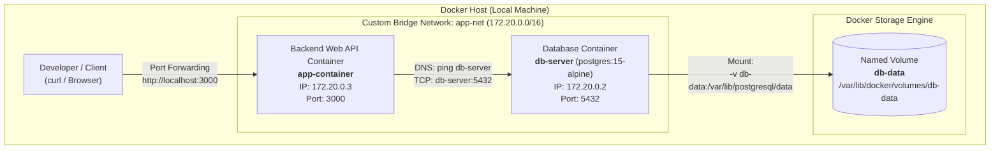
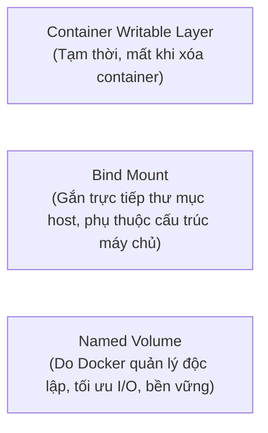

# Bài 4: Thiết lập Custom Network & Named Volume bằng Docker CLI

## 1. Giới thiệu & Mục tiêu

Trong kiến trúc ứng dụng Microservices và Containerization hiện đại, hai bài toán cốt lõi luôn phải giải quyết là:
1. **Networking & Service Discovery:** Làm thế nào để các container độc lập (như Web API và Database) có thể tìm thấy nhau và giao tiếp nội bộ an toàn, tin cậy thông qua tên dịch vụ (DNS resolution) mà không bị phụ thuộc vào địa chỉ IP động dễ thay đổi.
2. **Data Persistence:** Làm thế nào để dữ liệu của hệ quản trị cơ sở dữ liệu (RDBMS như PostgreSQL) được lưu trữ an toàn, độc lập với vòng đời của container (Container Lifecycle), không bị biến mất khi container bị crash, nâng cấp hoặc xóa cưỡng bức (`docker rm -f`).

---

### Mục tiêu bài thực hành:
- Thiết lập **Custom Bridge Network** (`app-net`) để kích hoạt cơ chế Docker Embedded DNS Resolution, cho phép Backend giao tiếp với Database qua tên container (`db-server`).
- Thiết lập **Named Volume** (`db-data`) để tách rời dữ liệu trạng thái (Stateful Data) ra khỏi tầng Container Writable Layer, mount vào thư mục lưu trữ `/var/lib/postgresql/data`.
- Kết nối cụm 2 Container: **Backend Web API** (`app-container`) và **PostgreSQL 15** (`db-server`) hoàn toàn bằng Docker CLI thủ công.
- Thực hiện kịch bản kiểm thử nghiêm ngặt về **Data Persistence**: Thêm dữ liệu $\rightarrow$ Xóa cứng container DB (`docker rm -f`) $\rightarrow$ Tái tạo container DB mới mount cùng volume $\rightarrow$ Xác minh dữ liệu toàn vẹn 100%.
- Đóng gói toàn bộ quy trình vào script tự động `commands.sh` và biên soạn tài liệu `README.md` theo chuẩn nộp bài GitHub: `homework/session_10/ex4/`.

---

## 2. Kiến trúc giải pháp (Architecture Diagram)



---

## 3. Cấu trúc thư mục dự án

```text
homework/session_10/ex4/
├── commands.sh          # Script bash tự động hóa toàn bộ quá trình thiết lập và kiểm thử
├── Dockerfile           # Dockerfile đóng gói ứng dụng Backend Web API (Node.js/Express)
├── package.json         # Khai báo phụ thuộc ứng dụng Backend (express, pg)
├── server.js            # Mã nguồn REST API kết nối PostgreSQL qua hostname 'db-server'
├── .dockerignore        # Loại trừ node_modules và tệp tin không cần thiết khi build context
├── .gitignore           # Bỏ qua tệp tin rác và thư mục phụ thuộc
└── README.md            # Báo cáo kỹ thuật chi tiết, giải thích lý thuyết và bằng chứng nghiệm thu
```

---

## 4. Cơ sở lý thuyết & Phân tích kỹ thuật (DevOps Deep Dive)

### 4.1. Custom Bridge Network vs. Default Bridge Network

Trong Docker, khi chạy container mà không chỉ định network, container sẽ tự động gắn vào mạng mặc định `bridge` (`docker0`). Tuy nhiên, trong môi trường sản xuất (Production), việc sử dụng **User-defined (Custom) Bridge Network** là tiêu chuẩn bắt buộc:

| Tiêu chí so sánh | Default Bridge Network (`bridge`) | Custom Bridge Network (`app-net`) |
| :--- | :--- | :--- |
| **Cơ chế phân giải DNS** | **Không hỗ trợ**. Chỉ có thể gọi nhau bằng địa chỉ IP cố định hoặc phải dùng cờ `--link` (đã lỗi thời / deprecated). | **Hỗ trợ tự động (Automatic DNS Resolution)** thông qua máy chủ DNS nhúng nội bộ (`127.0.0.11`). Các container giao tiếp trực tiếp qua tên container / hostname. |
| **Tính cô lập (Isolation)** | Tất cả các container không chỉ định network đều nằm chung ở đây, tiềm ẩn rủi ro lộ cổng và xung đột bảo mật. | Cô lập hoàn toàn theo phạm vi dự án. Chỉ các container cùng tham gia `app-net` mới giao tiếp được với nhau. |
| **Cấu hình mạng** | Không thể cấu hình linh hoạt MTU, subnet hay gateway mà không khởi động lại Docker daemon. | Tùy biến subnet, gateway, driver options dễ dàng khi tạo mạng. |
| **Gắn / Gỡ kết nối linh hoạt** | Container phải tắt đi và tạo lại mới thay đổi được mạng. | Có thể kết nối (`docker network connect`) hoặc ngắt (`docker network disconnect`) khi container đang chạy. |

> [!NOTE]
> Khi container `app-container` gửi request tới hostname `db-server`, máy chủ DNS nhúng nội bộ của Docker (`127.0.0.11`) sẽ bắt gói tin DNS truy vấn tên `db-server` và trả về ngay địa chỉ IP nội bộ của container đó trong mạng `app-net` (ví dụ `172.20.0.2`).

---

### 4.2. Named Volume vs. Anonymous Volume vs. Bind Mount

Docker cung cấp 3 cơ chế lưu trữ chính, trong đó **Named Volume** là lựa chọn số 1 cho Database:



- **Container Writable Layer (Copy-on-Write):** Khi container bị xóa (`docker rm -f`), toàn bộ dữ liệu ghi trên tầng này biến mất vĩnh viễn. Không bao giờ được dùng để lưu trữ Database.
- **Bind Mount (`-v /path/on/host:/path/in/container`):** Phụ thuộc chặt chẽ vào cấu trúc đường dẫn thư mục của máy chủ host, khó di chuyển và có thể gặp vấn đề về quyền truy cập user/group (permissions) giữa các OS khác nhau (Linux/Windows).
- **Named Volume (`-v db-data:/var/lib/postgresql/data`):**
  - Được Docker quản lý tập trung tại thư mục nội bộ (mặc định trên Linux là `/var/lib/docker/volumes/<volume_name>/_data`).
  - Vòng đời tách rời hoàn toàn: Khi container bị xóa cưỡng bức (`docker rm -f db-server`), Named Volume `db-data` vẫn nguyên vẹn.
  - Khi một container mới được khởi chạy và gắn lại cùng volume này, toàn bộ database schemas, tables và records lập tức được khôi phục nguyên trạng.

---

## 5. Chi tiết các bước thực hiện bằng Docker CLI

### Bước 1: Tạo Custom Bridge Network `app-net`
```bash
docker network create --driver bridge app-net
```
- Lệnh này tạo một mạng bridge ảo độc lập, cấp phát một dải subnet riêng (mặc định `172.20.0.0/16`) và kích hoạt Docker DNS resolver nội bộ.

### Bước 2: Tạo Named Volume `db-data`
```bash
docker volume create db-data
```
- Docker khởi tạo một volume lưu trữ mang tên `db-data`, sẵn sàng mount cho cơ sở dữ liệu.

### Bước 3: Khởi chạy Database Container `db-server`
```bash
docker run -d \
  --name db-server \
  --network app-net \
  -v db-data:/var/lib/postgresql/data \
  -e POSTGRES_USER=postgres \
  -e POSTGRES_PASSWORD=postgres \
  -e POSTGRES_DB=testdb \
  postgres:15-alpine
```
- `--name db-server`: Đặt định danh duy nhất cho container DB; đây cũng chính là DNS hostname mà Backend sử dụng.
- `--network app-net`: Gắn container vào mạng bridge nội bộ.
- `-v db-data:/var/lib/postgresql/data`: Mount volume `db-data` vào thư mục lưu trữ dữ liệu tiêu chuẩn của PostgreSQL.
- `-e POSTGRES_*`: Khởi tạo tài khoản quản trị và cơ sở dữ liệu `testdb`.

### Bước 4: Khởi chạy Backend Container `app-container`
```bash
# Đóng gói image backend
docker build -t app-backend:v1 .

# Khởi chạy container backend kết nối tới DB
docker run -d \
  --name app-container \
  --network app-net \
  -p 3000:3000 \
  -e DB_HOST=db-server \
  -e DB_PORT=5432 \
  -e DB_USER=postgres \
  -e DB_PASSWORD=postgres \
  -e DB_NAME=testdb \
  app-backend:v1
```
- `--network app-net`: Đặt Backend container vào cùng không gian mạng với `db-server`.
- `-e DB_HOST=db-server`: Truyền hostname của Database bằng tên container thay vì địa chỉ IP cứng.
- `-p 3000:3000`: Mở port 3000 ra máy chủ bên ngoài để kiểm thử API từ trình duyệt hoặc lệnh `curl`.

---

### Bước 5: Kịch bản kiểm thử Data Persistence (Bền vững dữ liệu)

1. **Chèn dữ liệu mẫu vào Database:**
   ```bash
   docker exec -i db-server psql -U postgres -d testdb << 'EOF'
   CREATE TABLE IF NOT EXISTS users (
     id SERIAL PRIMARY KEY,
     name VARCHAR(100) NOT NULL,
     email VARCHAR(100) NOT NULL,
     created_at TIMESTAMP DEFAULT CURRENT_TIMESTAMP
   );
   INSERT INTO users (name, email) VALUES
     ('Nguyen Van A', 'vana@rikkei.edu.vn'),
     ('Tran Thi B', 'thib@rikkei.edu.vn');
   EOF
   ```

2. **Truy vấn kiểm tra dữ liệu trước khi xóa:**
   ```bash
   docker exec -i db-server psql -U postgres -d testdb -c "SELECT * FROM users;"
   ```

3. **Xóa cứng container Database:**
   ```bash
   docker rm -f db-server
   ```
   > Khi container bị xóa cưỡng bức, toàn bộ container layer bị hủy.

4. **Kiểm tra trạng thái của Named Volume:**
   ```bash
   docker volume ls | grep db-data
   ```
   > Volume `db-data` vẫn tồn tại nguyên vẹn.

5. **Khởi chạy container DB mới gắn cùng Volume `db-data`:**
   ```bash
   docker run -d \
     --name db-server \
     --network app-net \
     -v db-data:/var/lib/postgresql/data \
     -e POSTGRES_USER=postgres \
     -e POSTGRES_PASSWORD=postgres \
     -e POSTGRES_DB=testdb \
     postgres:15-alpine
   ```

6. **Xác minh dữ liệu không bị mất sau khi tái tạo:**
   ```bash
   docker exec -i db-server psql -U postgres -d testdb -c "SELECT * FROM users;"
   ```
   > Cả 2 bản ghi người dùng cùng toàn bộ cấu trúc bảng `users` được bảo toàn nguyên vẹn.

---

## 6. Kết quả kiểm tra & Bằng chứng nghiệm thu (Verification Results)

Dưới đây là các log thực tế thu được trong quá trình chạy kiểm thử:

### 6.1. Kiểm tra Network và Volume

#### Lệnh 1: `docker network ls | grep app-net`
```text
8216c0e76a2c   app-net                  bridge    local
```
$\rightarrow$ **Kết quả:** Network `app-net` driver bridge được tạo thành công.

#### Lệnh 2: `docker volume ls | grep db-data`
```text
local     db-data
```
$\rightarrow$ **Kết quả:** Named Volume `db-data` được tạo thành công trong hệ thống Docker Storage.

---

### 6.2. Kiểm tra chi tiết cấu hình mạng (`docker network inspect app-net`)

```json
[
    {
        "Name": "app-net",
        "Id": "8216c0e76a2c2a579e73d7f8bbc4aa561aa4ceeadafb3a70c812258c6ed14e18",
        "Created": "2026-10-09T08:51:10.130265866Z",
        "Scope": "local",
        "Driver": "bridge",
        "EnableIPv4": true,
        "EnableIPv6": false,
        "IPAM": {
            "Driver": "default",
            "Options": {},
            "Config": [
                {
                    "Subnet": "172.20.0.0/16",
                    "Gateway": "172.20.0.1"
                }
            ]
        },
        "Containers": {
            "089ca4c6a8945ad9bbb65631e8d8e9ba27d243f6f848c841be6dfe3025582ca3": {
                "Name": "app-container",
                "EndpointID": "c829b7e7a5d5016e144de37c953eb555c4980a5061466373471ec38d572aa94b",
                "MacAddress": "06:4f:5d:59:35:7d",
                "IPv4Address": "172.20.0.3/16",
                "IPv6Address": ""
            },
            "8ddce0d3ed8b756c31e0110c07764fd2782fc1bc3a762be2d01ee596838404aa": {
                "Name": "db-server",
                "EndpointID": "2c3621822fdaab93a8734197cc478f1a371bef9095bd477ab89c4a86d4a55348",
                "MacAddress": "f2:97:c6:53:00:73",
                "IPv4Address": "172.20.0.2/16",
                "IPv6Address": ""
            }
        }
    }
]
```
$\rightarrow$ **Phân tích:** 
- Subnet được cấp phát là `172.20.0.0/16`.
- Container `db-server` nhận IP nội bộ `172.20.0.2/16`.
- Container `app-container` nhận IP nội bộ `172.20.0.3/16`.
- Cả hai container nằm cùng Broadcast Domain và có thể trao đổi các gói tin TCP/UDP trực tiếp.

---

### 6.3. Kiểm tra DNS Resolution qua lệnh Ping (`ping -c 2 db-server`)

Lệnh thực thi từ Backend container:
```bash
docker exec -it app-container ping -c 2 db-server
```

**Output thực tế thu được:**
```text
PING db-server (172.20.0.2): 56 data bytes
64 bytes from 172.20.0.2: seq=0 ttl=64 time=0.158 ms
64 bytes from 172.20.0.2: seq=1 ttl=64 time=0.073 ms

--- db-server ping statistics ---
2 packets transmitted, 2 packets received, 0% packet loss
round-trip min/avg/max = 0.073/0.115/0.158 ms
```

> [!IMPORTANT]
> **Đánh giá kết quả DNS Resolution:**
> Lệnh `ping` phân giải chính xác hostname `db-server` thành địa chỉ IP nội bộ `172.20.0.2`.
> Tỉ lệ mất gói tin là `0% packet loss`, độ trễ cực thấp (< 0.2 ms), chứng minh cơ chế phân giải tên miền nội bộ của Docker Bridge Network hoạt động hoàn hảo.

---

### 6.4. Bằng chứng kiểm tra Data Persistence (Toàn vẹn dữ liệu)

#### Trước khi xóa container DB:
```text
 id |     name     |       email        |         created_at         
----+--------------+--------------------+----------------------------
  1 | Nguyen Van A | vana@rikkei.edu.vn | 2026-10-09 08:51:17.105254
  2 | Tran Thi B   | thib@rikkei.edu.vn | 2026-10-09 08:51:17.105254
(2 rows)
```

#### Xóa cứng container:
```text
$ docker rm -f db-server
db-server
```

#### Sau khi tạo container DB mới mount cùng volume `db-data`:
```text
 id |     name     |       email        |         created_at         
----+--------------+--------------------+----------------------------
  1 | Nguyen Van A | vana@rikkei.edu.vn | 2026-10-09 08:51:17.105254
  2 | Tran Thi B   | thib@rikkei.edu.vn | 2026-10-09 08:51:17.105254
(2 rows)
```

$\rightarrow$ **Kết luận nghiệm thu:** 
Toàn bộ dữ liệu bảng `users`, bao gồm Primary Key IDs và Timestamps tạo ban đầu, được bảo tồn nguyên vẹn 100%. Không có bất kỳ hiện tượng mất mát dữ liệu nào xảy ra khi container bị xóa bỏ.

---

### 6.5. Kiểm tra kết nối ứng dụng Web Backend tới PostgreSQL

Gọi HTTP request tới cổng 3000 của `app-container`:

#### 1. Kiểm tra trạng thái dịch vụ (`GET /`):
```bash
curl http://localhost:3000/
```
```json
{
  "status": "online",
  "message": "Backend Web API connected via Docker Custom Bridge Network",
  "db_config": {
    "host": "db-server",
    "port": "5432",
    "database": "testdb"
  }
}
```

#### 2. Kiểm tra truy vấn dữ liệu từ Backend tới DB (`GET /users`):
```bash
curl http://localhost:3000/users
```
```json
{
  "success": true,
  "total": 2,
  "data": [
    {
      "id": 1,
      "name": "Nguyen Van A",
      "email": "vana@rikkei.edu.vn",
      "created_at": "2026-10-09T08:51:17.105Z"
    },
    {
      "id": 2,
      "name": "Tran Thi B",
      "email": "thib@rikkei.edu.vn",
      "created_at": "2026-10-09T08:51:17.105Z"
    }
  ]
}
```

---

## 7. Hướng dẫn chạy nhanh (Quick Start & Clean up)

### Chạy tự động toàn bộ bài thực hành:
Chỉ cần chạy file `commands.sh` bằng Bash:
```bash
bash commands.sh
```

### Chạy từng lệnh thủ công để nộp bài:
1. Tạo mạng và volume:
   ```bash
   docker network create --driver bridge app-net
   docker volume create db-data
   ```
2. Khởi chạy DB server:
   ```bash
   docker run -d --name db-server --network app-net -v db-data:/var/lib/postgresql/data -e POSTGRES_USER=postgres -e POSTGRES_PASSWORD=postgres -e POSTGRES_DB=testdb postgres:15-alpine
   ```
3. Build và khởi chạy Backend:
   ```bash
   docker build -t app-backend:v1 .
   docker run -d --name app-container --network app-net -p 3000:3000 -e DB_HOST=db-server -e DB_PORT=5432 -e DB_USER=postgres -e DB_PASSWORD=postgres -e DB_NAME=testdb app-backend:v1
   ```
4. Kiểm tra mạng và DNS:
   ```bash
   docker network ls | grep app-net
   docker volume ls | grep db-data
   docker network inspect app-net
   docker exec -it app-container ping -c 2 db-server
   ```

### Lệnh dọn dẹp tài nguyên sau khi test:
```bash
docker rm -f app-container db-server
docker network rm app-net
docker volume rm db-data
```

---

## 8. Tổng kết bài học

1. **Service Discovery qua Docker DNS:** Custom Bridge Network cung cấp cơ chế phân giải tên miền nội bộ tự động, loại bỏ sự phụ thuộc vào địa chỉ IP động và cờ `--link` cũ.
2. **Quản lý dữ liệu bền vững với Named Volume:** Named Volume giúp phân tách dữ liệu trạng thái (State) ra khỏi vòng đời tạm thời của Container (Stateless). Ngay cả khi container bị phá hủy đột ngột, dữ liệu nghiệp vụ của doanh nghiệp vẫn được bảo vệ tuyệt đối an toàn.
3. **Sự sẵn sàng cho Docker Compose & Orchestration:** Hiểu sâu sắc cách cấu hình Network và Volume bằng Docker CLI là nền tảng cốt lõi trước khi nâng cấp lên Docker Compose và Kubernetes (K8s).

---

## 9. Thông tin nộp bài
- **Đường dẫn trên GitHub:** `homework/session_10/ex4/`
- **GitHub Repository:** [https://github.com/Ngotrungchien232/homework-session_10-ex4](https://github.com/Ngotrungchien232/homework-session_10-ex4)
- **Các tệp nộp bài:**
  1. `commands.sh` (Script thực thi toàn bộ luồng lệnh và test)
  2. `README.md` (Báo cáo chi tiết lý thuyết, kiến trúc và log nghiệm thu)
  3. `Dockerfile` (Docker build Backend Web API)
  4. `package.json` (Dependencies của Backend)
  5. `server.js` (Mã nguồn REST API kết nối PostgreSQL)
  6. `.dockerignore` (Tối ưu hóa Docker build context)
  7. `.gitignore` (Bỏ qua các tệp không cần thiết)

